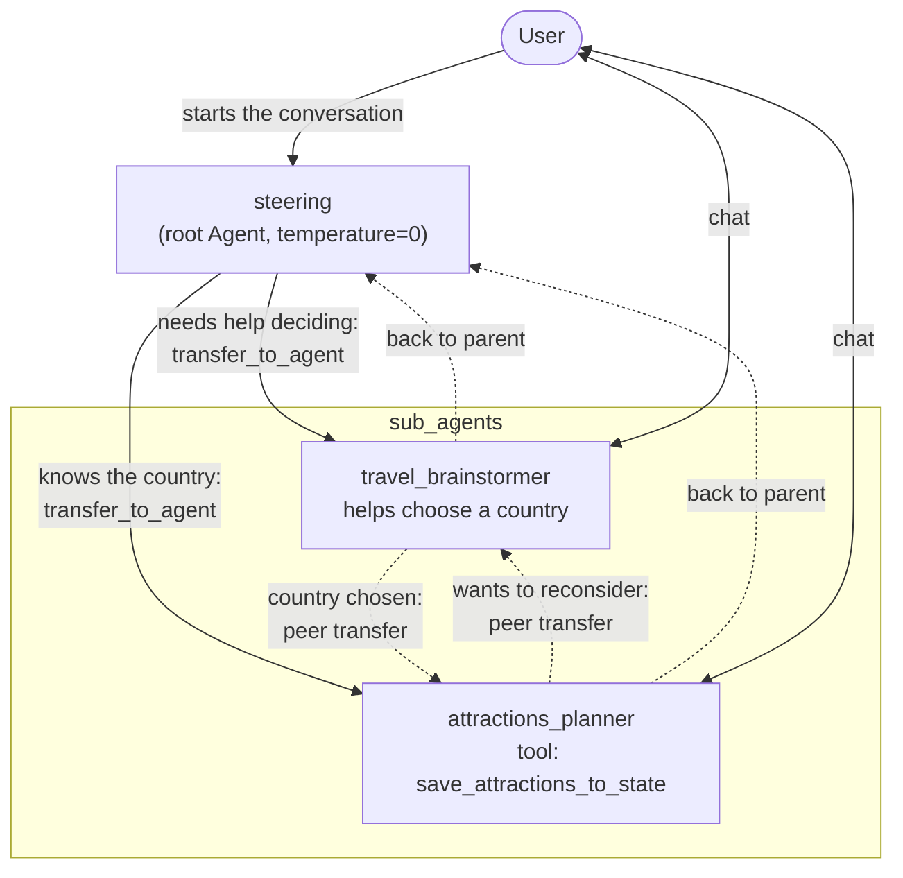
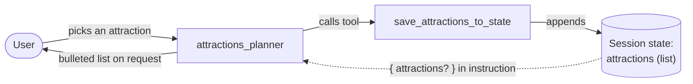

# Parent and sub-agents: how the agents communicate

The travel planner in [agent.py](agent.py) is a single parent agent with two sub-agents, and no workflow agents. The model decides where the conversation goes: each agent can call ADK's built-in `transfer_to_agent` function to hand the conversation to another agent, choosing by the other agents' `description`. Whichever agent receives the transfer answers the user directly, and the user's next messages go to it until it transfers again.

ADK's defaults (`disallow_transfer_to_parent=False`, `disallow_transfer_to_peers=False`) let the sub-agents transfer back to `steering` or straight to each other. The parent's instruction only defines the first routing decision.

## Control flow

Solid arrows are the routes the `steering` instruction asks for. Dashed arrows are transfers ADK allows by default, which the model may choose when the conversation calls for it.

## Data flow through session state

Only `attractions_planner` uses session state. Each time the user picks an attraction, its tool appends to the `attractions` list. When the user asks to see the list, the agent's instruction reads it back through the `{ attractions? }` template.

## Logging

`travel_brainstormer` and `attractions_planner` have `before_model_callback=log_query_to_model` and `after_model_callback=log_model_response` from `callback_logging.py`. These log every user query, model reply and function call (including transfers) to Cloud Logging, or to standard logging when Cloud Logging isn't set up. `steering` has no callbacks, so its turns aren't logged this way.

## Summary

| Agent | Role | Transfers to | Reads from state | Writes to state | Tools |
|---|---|---|---|---|---|
| `steering` | Root, routes the user | `travel_brainstormer`, `attractions_planner` | none | none | none (only the built-in transfer) |
| `travel_brainstormer` | Helps pick a country by travel goals | `steering`, `attractions_planner` | none | none | none |
| `attractions_planner` | Suggests attractions and saves the user's picks | `steering`, `travel_brainstormer` | `attractions` | `attractions` | `save_attractions_to_state` |
