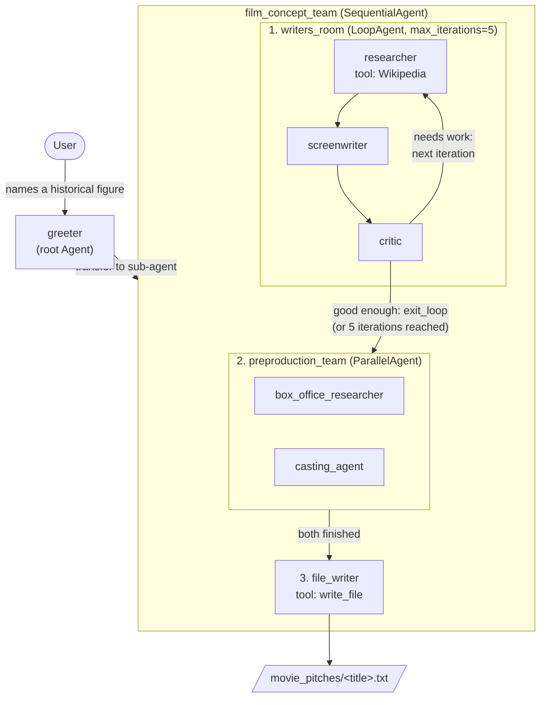
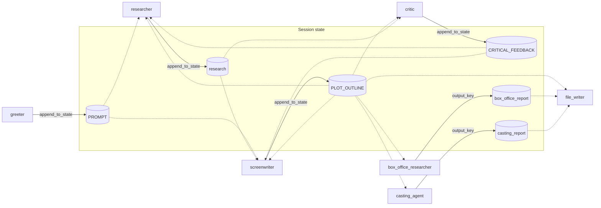

# Workflow agents: how the agents communicate

The movie-pitch system in [agent.py](agent.py) nests three kinds of workflow agent under one root agent. The agents never call each other directly. Control passes through the workflow structure (transfer, sequence, loop, parallel), and data passes through **session state**: each agent writes to state keys, and later agents read them in their instructions through `{ KEY? }` templates.

## Control flow

## Data flow through session state

Solid arrows are writes and dashed arrows are reads. The `append_to_state` tool appends to a list, so `research`, `PLOT_OUTLINE` and `CRITICAL_FEEDBACK` grow with each loop iteration. The parallel agents write a single value with `output_key`.

## Summary

| Agent | Type | Reads from state | Writes to state | Tools |
|---|---|---|---|---|
| `greeter` | `Agent` (root) | none | `PROMPT` | `append_to_state` |
| `film_concept_team` | `SequentialAgent` | none | none | none |
| `writers_room` | `LoopAgent` | none | none | none |
| `researcher` | `Agent` | `PROMPT`, `PLOT_OUTLINE`, `CRITICAL_FEEDBACK` | `research` | Wikipedia, `append_to_state` |
| `screenwriter` | `Agent` | `PROMPT`, `PLOT_OUTLINE`, `research`, `CRITICAL_FEEDBACK` | `PLOT_OUTLINE` | `append_to_state` |
| `critic` | `Agent` | `PLOT_OUTLINE`, `research` | `CRITICAL_FEEDBACK` | `append_to_state`, `exit_loop` |
| `preproduction_team` | `ParallelAgent` | none | none | none |
| `box_office_researcher` | `Agent` | `PLOT_OUTLINE` | `box_office_report` | none |
| `casting_agent` | `Agent` | `PLOT_OUTLINE` | `casting_report` | none |
| `file_writer` | `Agent` | `PLOT_OUTLINE`, `box_office_report`, `casting_report` | none (writes a file) | `write_file` |
